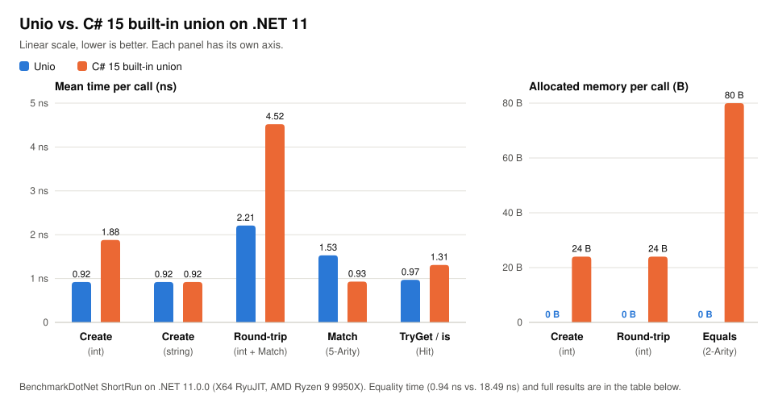

<div align="center">


# Unio

**High-performance discriminated unions for .NET**

Zero-allocation `readonly struct` unions (`Unio<T0, T1>` .. `Unio<T0, ..., T19>`) with exhaustive `Match`/`Switch`, `TryGet` patterns, a Roslyn incremental source generator for named union types, 39 pre-built result types, and ASP.NET Core Minimal API integration.

[](https://github.com/BenjaminAbt/Unio/actions/workflows/main-build.yml)
[](#build-and-test)
[](https://nubrowse.com/packages/Unio)
[](https://nubrowse.com/packages/Unio)
[](LICENSE)

[](https://dotnet.microsoft.com/)
[](#native-aot-and-trimming)
[](#native-aot-and-trimming)
[](https://learn.microsoft.com/dotnet/standard/assembly/strong-named)
[](https://learn.microsoft.com/dotnet/standard/library-guidance/sourcelink)

[](https://github.com/BenjaminAbt/Unio/stargazers)
[](https://github.com/BenjaminAbt/Unio/commits/main)
[](https://github.com/BenjaminAbt/Unio/issues)

</div>

## NuGet

| Package | Version | Downloads | Install |
| --- | --- | --- | --- |
| **[Unio](https://nubrowse.com/packages/Unio)**<br><sub>Core `readonly struct` unions (`Unio<T0, T1>` .. `Unio<T0, ..., T19>`), `UnioBase<...>`, and `[GenerateUnio]`</sub> | [](https://nubrowse.com/packages/Unio) | [](https://nubrowse.com/packages/Unio) | `dotnet add package Unio` |
| **[Unio.SourceGenerator](https://nubrowse.com/packages/Unio.SourceGenerator)**<br><sub>Roslyn incremental source generator for class-based named union types</sub> | [](https://nubrowse.com/packages/Unio.SourceGenerator) | [](https://nubrowse.com/packages/Unio.SourceGenerator) | `dotnet add package Unio.SourceGenerator` |
| **[Unio.Types](https://nubrowse.com/packages/Unio.Types)**<br><sub>39 pre-built sentinel markers and value-carrying result types</sub> | [](https://nubrowse.com/packages/Unio.Types) | [](https://nubrowse.com/packages/Unio.Types) | `dotnet add package Unio.Types` |
| **[Unio.AspNetCore](https://nubrowse.com/packages/Unio.AspNetCore)**<br><sub>ASP.NET Core Minimal API integration (`ToHttpResult()`)</sub> | [](https://nubrowse.com/packages/Unio.AspNetCore) | [](https://nubrowse.com/packages/Unio.AspNetCore) | `dotnet add package Unio.AspNetCore` |
| **[Unio.Extensions](https://nubrowse.com/packages/Unio.Extensions)**<br><sub>Fluent functional extensions (`Map`, `Bind`, `Tap`, `Ensure`, `Recover`) and `Task` helpers</sub> | [](https://nubrowse.com/packages/Unio.Extensions) | [](https://nubrowse.com/packages/Unio.Extensions) | `dotnet add package Unio.Extensions` |

The runtime NuGet packages target .NET 9, 10, and 11; `Unio.SourceGenerator` targets `netstandard2.0` as a build-time Roslyn analyzer. Building the solution requires the .NET 11 SDK.

## Why Unio?

Discriminated unions model mutually exclusive states without exceptions or `null`. Even with C# 15's [built-in `union` types](https://learn.microsoft.com/dotnet/csharp/language-reference/builtin-types/union) (.NET 11), the default compiler-generated form stores values in an `object?` field-boxing value types and adding GC pressure-and requires .NET 11+. Existing libraries often rely on class hierarchies or `object` storage with similar trade-offs. See [Unio vs. C# 15 Built-in `union`](#unio-vs-c-15-built-in-union) for a detailed feature and benchmark comparison.

**Unio** takes a modern, performance-first approach:

- **Typed generic fields** - no casts to `object`, no boxing during construction or matching
- **Exhaustive matching** - `Match<TResult>` and `Switch` enforce handling of every union branch at compile time
- **Allocation-free matching** - `Match<TState, TResult>` and `Switch<TState>` pass context to `static` lambdas instead of allocating closures; `Task`-returning overloads cover async workflows
- **Safe access** - `TryGetT0..TryGetTn` and `TryPickT0..TryPickTn` follow the familiar `TryParse` idiom without exceptions
- **Full structural equality** - `IEquatable<T>`, `==`, `!=`, `GetHashCode()`, plus `IFormattable`, `ISpanFormattable`, and `IUtf8SpanFormattable`
- **Source generator** - declare named unions like `StringOrInt` with `[GenerateUnio]` and zero boilerplate
- **Pre-built types** - 39 sentinel and value-carrying types for common domain and HTTP outcomes (`Success<T>`, `NotFound`, `ValidationError`, etc.)
- **Native AOT & trimming** - all runtime packages enable AOT and trim analyzers and are verified as native binaries in CI

## Usage

### Generic Union Types

```csharp
using Unio;

// Create via implicit conversion - the compiler picks the right slot
Unio<int, string> result = 42;
Unio<int, string> error = "Something went wrong";

// Exhaustive pattern matching - the compiler ensures all cases are handled
string message = result.Match(
    value => $"Success: {value}",
    err   => $"Error: {err}");

// Type checking via IsT# properties
if (result.IsT0)
    Console.WriteLine($"Got int: {result.AsT0}");

// Safe access with TryGet - no exceptions thrown
if (result.TryGetT0(out int number))
    Console.WriteLine($"Number: {number}");

// Side-effect switching
result.Switch(
    value => Console.WriteLine($"Value: {value}"),
    err   => Console.Error.WriteLine($"Error: {err}"));
```

### Named Union Types (Source Generator)

Create strongly-typed, named union types with zero boilerplate using `Unio.SourceGenerator`:

```csharp
using Unio;

[GenerateUnio]
public partial class StringOrInt : UnioBase<string, int>;

[GenerateUnio]
public partial class ApiResult : UnioBase<User, NotFound, ValidationError>;
```

The source generator produces a `sealed` class with implicit conversions and typed equality while inheriting all union operations from `UnioBase<...>`:

```csharp
StringOrInt value = "hello";

if (value.IsT0)
    Console.WriteLine(value.AsT0);  // "hello"

string result = value.Match(
    s => $"string: {s}",
    i => $"int: {i}");

// Equality works out of the box
StringOrInt a = 42;
StringOrInt b = 42;
bool equal = a == b;  // true

// TryGet, Switch - everything is available
if (value.TryGetT0(out string str))
    Console.WriteLine(str);
```

### Pre-built Types (`Unio.Types`)

Use `Unio.Types` for ready-made marker structs and value-carrying wrappers:

```csharp
using Unio;
using Unio.Types;

// API result pattern with pre-built markers
Unio<User, NotFound, Forbidden> GetUser(int id)
{
    if (!IsAuthorized()) return new Forbidden();
    var user = _repo.Find(id);
    return user is not null ? user : new NotFound();
}

// Rich results with value-carrying types
Unio<Success<Order>, ValidationError, Conflict> CreateOrder(OrderRequest req)
{
    if (!Validate(req, out var errors)) return new ValidationError(errors);
    if (HasConflict(req)) return new Conflict();
    return new Success<Order>(ProcessOrder(req));
}
```

### ASP.NET Core Minimal APIs (`Unio.AspNetCore`)

Map union results directly to `IResult` HTTP responses with `ToHttpResult()`:

```csharp
using Unio;
using Unio.AspNetCore.MinimalApi;
using Unio.Types;

app.MapGet("/users/{id:int}", (int id, IUserService svc) =>
{
    Unio<User, NotFound, Forbidden> result = svc.GetUser(id);
    return result.ToHttpResult(); // User -> 200 OK, NotFound -> 404, Forbidden -> 403
});
```

### Functional Extensions (`Unio.Extensions`)

Compose transformations, validation, side effects, recovery, and `Task`-based pipelines fluently:

```csharp
using Unio;
using Unio.Extensions;

Unio<int, string> value = "invalid";

int normalized = value
    .TapT1(static error => Console.WriteLine(error))
    .EnsureT1(static e => e.Length < 20, static _ => -1)
    .RecoverT1(static _ => -1);

Unio<double, string> asyncMapped = await ((Unio<int, string>)21)
    .BindT0Async(static i => Task.FromResult(i * 2.0));
```

## API Reference

### Union Type Members

Each `Unio<...>` (both generic `readonly struct` and `UnioBase<...>` named unions) provides **2 to 20 type parameters** (`Unio<T0, T1>` through `Unio<T0, ..., T19>`):

| Member | Return Type | Description |
| --- | --- | --- |
| `Index` | `int` | Zero-based index of the currently stored type |
| `Value` | `object` | Currently stored value (boxed for value types) |
| `IsT0` .. `IsTn` | `bool` | Returns `true` if the union holds the type at that index |
| `AsT0` .. `AsTn` | `T0` .. `Tn` | Returns the value; throws `InvalidOperationException` if wrong type |
| `TryGetT0(out T0)` .. `TryGetTn(out Tn)` | `bool` | Returns `true` and sets `out` parameter if the type matches |
| `TryPickT0(out T0, out ...)` .. `TryPickTn(out Tn, out ...)` | `bool` | Returns `true` if matched; otherwise returns `false` and provides the remainder value or union |
| `ValueOrT0(T0)` .. `ValueOrTn(Func<Tn>)` | `T0` .. `Tn` | Returns the stored value if active, or an eager/lazy fallback |
| `MapT0(Func<T0, TNew>)` .. `MapTn(...)` | `Unio<...>` | Transforms one branch while preserving the remaining union types |
| `Match<TResult>(Func<T0, TResult>, ...)` | `TResult` | Exhaustive functional match - one function per type |
| `Match<TState, TResult>(TState, Func<TState, T0, TResult>, ...)` | `TResult` | Allocation-free match - passes `state` to `static` lambdas |
| `Switch(Action<T0>, ...)` | `void` | Exhaustive side-effect switch - one action per type |
| `Switch<TState>(TState, Action<TState, T0>, ...)` | `void` | Allocation-free switch - passes `state` to `static` lambdas |
| `Match<TResult>(Func<T0, Task<TResult>>, ...)` | `Task<TResult>` | Exhaustive async functional match |
| `Match<TState, TResult>(TState, Func<TState, T0, Task<TResult>>, ...)` | `Task<TResult>` | Allocation-free async match - passes `state` to `static` lambdas |
| `Switch(Func<T0, Task>, ...)` | `Task` | Exhaustive async side-effect switch |
| `Switch<TState>(TState, Func<TState, T0, Task>, ...)` | `Task` | Allocation-free async switch - passes `state` to `static` lambdas |
| `Equals(other)` / `==` / `!=` / `GetHashCode()` | `bool` / `int` | Structural value equality via `IEquatable<T>` |
| `ToString(...)` / `TryFormat(...)` | `string` / `bool` | Delegates formatting via `IFormattable`, `ISpanFormattable`, and `IUtf8SpanFormattable` |

### Implicit Conversions & Equality

Every union type defines implicit conversion operators from each constituent type and implements `IEquatable<T>` with structural equality:

```csharp
Unio<int, string, bool> a = 42;      // stores int at index 0
Unio<int, string, bool> b = 42;
Unio<int, string, bool> c = "hello"; // stores string at index 1

bool same = a == b;       // true  - same index and value
bool different = a == c;  // false - different active types

var set = new HashSet<Unio<int, string, bool>> { a, b, c };
// set.Count == 2
```

### Allocation-Free Matching with `TState`

When a lambda captures local variables, the C# compiler allocates a closure object per call. Pass context via `TState` with `static` lambdas (or a `ValueTuple` for multiple values) to eliminate closure allocations on hot paths:

```csharp
// ❌ captures `prefix` - allocates a closure object per call
string result = union.Match(
    i => $"{prefix}: {i}",
    s => $"{prefix}: {s}",
    b => $"{prefix}: {b}");

// ✅ passes `prefix` as TState to static lambdas - zero allocation
string result = union.Match(prefix,
    static (p, i) => $"{p}: {i}",
    static (p, s) => $"{p}: {s}",
    static (p, b) => $"{p}: {b}");

// Multiple state values via ValueTuple (sync or async)
await union.Switch((db, logger),
    static async (s, i)   => { await s.db.SaveAsync(i); s.logger.LogInformation("Saved {V}", i); },
    static async (s, str) => await s.db.LogAsync(str),
    static (_, _)         => Task.CompletedTask);
```

## Unio.Types

`Unio.Types` provides 39 pre-built `readonly struct` types with `IEquatable<T>`, `==`/`!=` operators, and `[AggressiveInlining]` equality members.

### Marker Types (Zero-Size Sentinels)

| Category | Types | Notes |
| --- | --- | --- |
| **Boolean / Ternary** | `Yes`, `No`, `Maybe`, `True`, `False`, `Unknown` | Zero-size state sentinels |
| **Collection** | `All`, `Some`, `None`, `Empty` | Option / match-quantity sentinels |
| **State** | `Pending`, `Cancelled`, `Timeout`, `Skipped`, `Invalid`, `Disabled`, `Expired`, `RateLimited` | Workflow and lifecycle states |
| **HTTP / API** | `BadRequest` (400), `Unauthorized` (401), `Forbidden` (403), `NotFound` (404), `Conflict` (409), `Accepted` (202), `NoContent` (204) | Automatically mapped by `Unio.AspNetCore` |
| **CRUD** | `Created` (201), `Updated`, `Deleted`, `Unchanged` | Persistence outcome markers |
| **Result** | `Success`, `Error` | Binary outcome markers |

### Value-Carrying Types

All value-carrying wrappers support implicit conversion from `T`, `IEquatable<T>`, `==`/`!=`, and descriptive `ToString()` formatting:

| Type | Property | Description | Example |
| --- | --- | --- | --- |
| `Success<T>` | `T Value` | Success with result value | `new Success<Order>(order)` |
| `Error<T>` | `T Value` | Error with typed details | `new Error<string>("msg")` |
| `Result<T>` | `T Value` | Generic result wrapper | `new Result<int>(42)` |
| `NotFound<T>` | `T Value` | Not found with identifier | `new NotFound<int>(userId)` |
| `Created<T>` | `T Value` | Created with entity or ID (HTTP 201) | `new Created<int>(newId)` |
| `Updated<T>` | `T Value` | Updated with entity | `new Updated<User>(user)` |
| `ValidationError` | `string Message` | Validation error message | `new ValidationError("Name required")` |
| `ValidationError<T>` | `T Value` | Typed validation error details | `new ValidationError<string[]>(errors)` |

## Source Generator

`Unio.SourceGenerator` is a Roslyn incremental generator (`IIncrementalGenerator`) that turns a minimal `partial class` declaration into a `sealed` named union inheriting from `UnioBase<...>`.

```csharp
[GenerateUnio]
public partial class Result : UnioBase<User, NotFound, ValidationError>;
```

Generated code stays minimal because all union members (`Index`, `IsT#`, `AsT#`, `TryGetT#`, `Match`, `Switch`, `MapT#`, `ValueOrT#`, formatting) are inherited from `UnioBase<...>`:

```csharp
public sealed partial class Result : IEquatable<Result>
{
    private Result(Unio<User, NotFound, ValidationError> union) : base(union) { }

    public Result(User value) : base((Unio<User, NotFound, ValidationError>)value) { }
    public Result(NotFound value) : base((Unio<User, NotFound, ValidationError>)value) { }
    public Result(ValidationError value) : base((Unio<User, NotFound, ValidationError>)value) { }

    public static implicit operator Result(User value);
    public static implicit operator Result(NotFound value);
    public static implicit operator Result(ValidationError value);

    public bool Equals(Result? other);
    public override bool Equals(object? obj);
    public override int GetHashCode();
    public static bool operator ==(Result? left, Result? right);
    public static bool operator !=(Result? left, Result? right);
}
```

### Diagnostics

| Code | Severity | Description |
| --- | --- | --- |
| `UNIO001` | Error | Class marked with `[GenerateUnio]` does not inherit from `UnioBase<...>` |
| `UNIO002` | Error | `UnioBase<...>` has unsupported arity (must be 2–20) |
| `UNIO003` | Error | Duplicate type arguments in `UnioBase<...>` |
| `UNIO005` | Error | Nested, generic, abstract, static, or file-local union declaration |
| `UNIO006` | Error | Union class is not `partial` |

Use top-level, non-generic `partial` classes; `UNIO004` is reserved.

## Real-World Examples

### CRUD & Validation

```csharp
using Unio;
using Unio.Types;

public Unio<Created<int>, ValidationError, Conflict> CreateProduct(ProductDto dto)
{
    if (string.IsNullOrEmpty(dto.Name))
        return new ValidationError("Name is required");

    if (_repo.ExistsByName(dto.Name))
        return new Conflict();

    return new Created<int>(_repo.Insert(dto));
}
```

### State Machine

```csharp
using Unio;
using Unio.Types;

[GenerateUnio]
public partial class JobState : UnioBase<Pending, Success<JobResult>, Error<string>, Cancelled, Timeout>;

JobState state = new Pending();
state = new Success<JobResult>(result);

string status = state.Match(
    _       => "Pending...",
    success => $"Done: {success.Value}",
    error   => $"Failed: {error.Value}",
    _       => "Cancelled",
    _       => "Timed out");
```

### Error Handling & Option Pattern

```csharp
using Unio;
using Unio.Types;

Unio<int, FormatException, OverflowException> SafeParse(string input)
{
    try { return int.Parse(input, CultureInfo.InvariantCulture); }
    catch (FormatException ex) { return ex; }
    catch (OverflowException ex) { return ex; }
}

Unio<string, None> FindName(int id) =>
    _db.FindName(id) is { } name ? name : new None();
```

<a id="native-aot"></a>

## Native AOT and trimming

All runtime packages declare `<IsAotCompatible>true</IsAotCompatible>`, enabling AOT, trimming, and single-file analyzers on every build:

| Package | Native AOT / trimming | Reference metadata verification |
| --- | --- | --- |
| `Unio` | Supported across all arities 2–20 and `UnioBase<...>` | Enabled for .NET 10+ |
| `Unio.Types` | Supported | Enabled for .NET 10+ |
| `Unio.Extensions` | Supported | Enabled for .NET 10+ |
| `Unio.SourceGenerator` | Generated code is supported; generator runs at build time | Not a runtime assembly |
| `Unio.AspNetCore` | Supported with source-generated `JsonSerializerContext` | Disabled for `Microsoft.AspNetCore.App` |

`VerifyReferenceAotCompatibility` (IL3058) is enabled on .NET 10+ where framework references include AOT metadata. `Microsoft.AspNetCore.App` contains assemblies without this metadata, so `Unio.AspNetCore` keeps code analysis enabled and verifies native execution via `samples/Unio.AspNetCore.NativeAot`.

Publish and run the native smoke apps and full-API rooting check:

```shell
dotnet publish samples/Unio.NativeAot -c Release -f net11.0 -r linux-x64 -o artifacts/aot/core
./artifacts/aot/core/Unio.NativeAot

dotnet publish samples/Unio.AspNetCore.NativeAot -c Release -f net11.0 -r linux-x64 -o artifacts/aot/http
./artifacts/aot/http/Unio.AspNetCore.NativeAot --smoke

dotnet publish tests/Unio.AotCompatibility -c Release -f net11.0 -r linux-x64 -o artifacts/aot/analysis
./artifacts/aot/analysis/Unio.AotCompatibility
```

On Windows use `-r win-x64` and the `.exe` binaries. Publishing with Native AOT requires the [platform toolchain](https://learn.microsoft.com/dotnet/core/deploying/native-aot/#prerequisites). For ASP.NET Core response bodies, pass `result.ToHttpResult(ApiJsonContext.Default)` or configure `ConfigureHttpJsonOptions` with a source-generated `JsonSerializerContext` (see [Unio.AspNetCore documentation](src/Unio.AspNetCore/readme.md)).

## Build and test

Use the .NET 11 SDK (`11.0.100`) pinned in `global.json` and install the .NET 9 and .NET 10 runtimes to run the full multi-targeted test suite.

```shell
dotnet build -c Release
dotnet test -c Release --no-build
```

Line and branch coverage of all five packages must stay at **100 %**. CI collects coverage on every build and fails below this threshold. Run the same check locally with `just test-cov`, or call `./eng/Assert-CodeCoverage.ps1 -ResultsDirectory TestResults -Threshold 100` after `dotnet test --coverlet --results-directory TestResults`.

| Target | C# version | Notes |
| --- | --- | --- |
| `net9.0` | 13 | Runtime packages & unit tests |
| `net10.0` | 14 | Runtime packages, `VerifyReferenceAotCompatibility`, & unit tests |
| `net11.0` | 15 | Runtime packages, benchmarks, & unit tests |
| `netstandard2.0` | Latest | `Unio.SourceGenerator` (Roslyn 5.0.0 for .NET 10+ SDK compatibility) |

Checked-in union arities (`Unio2`..`Unio20` and `UnioBase`) are generated from `tools/Unio.CodeGen`:

```shell
dotnet run --project tools/Unio.CodeGen --framework net11.0 -- src/Unio
```

## Release

Every push to `main` builds, tests, validates Native AOT on Linux and Windows, and creates a draft GitHub release with the NuGet (`.nupkg`) and symbol (`.snupkg`) packages. Publishing that release triggers `.github/workflows/release-publish.yml`, which pushes all packages to NuGet.org via [Trusted Publishing](https://learn.microsoft.com/nuget/nuget-org/trusted-publishing) using short-lived OIDC tokens instead of stored API keys.

## Benchmark

Run the BenchmarkDotNet suite on .NET 11:

```shell
dotnet run -c Release --project perf/Unio.Benchmarks/Unio.Benchmarks.csproj --framework net11.0
```

| Method | Mean | Error | Ratio | Allocated |
| --- | ---: | ---: | ---: | ---: |
| `Unio_Match_2Arity` | 0.7800 ns | 0.8268 ns | 1.00 | 0 B |
| `OneOf_Match_2Arity` | 0.7415 ns | 0.2101 ns | 0.95 | 0 B |
| `Unio_Match_5Arity` | 1.0782 ns | 1.2554 ns | 1.00 | 0 B |
| `OneOf_Match_5Arity` | 1.0814 ns | 0.1313 ns | 1.01 | 0 B |
| `Unio_Match_WithState_2Arity` | 4.8533 ns | 1.1143 ns | 1.00 | 48 B |
| `OneOf_Match_CapturingLambda_2Arity` | 5.6056 ns | 0.2197 ns | 1.16 | 72 B |
| `Unio_Match_WithState_5Arity` | 5.0281 ns | 0.6369 ns | 1.00 | 48 B |
| `OneOf_Match_CapturingLambda_5Arity` | 5.7137 ns | 0.2740 ns | 1.14 | 72 B |
| `Unio_Switch_WithState_2Arity` | 0.6918 ns | 0.0947 ns | 1.00 | 0 B |
| `OneOf_Switch_CapturingLambda_2Arity` | 1.9457 ns | 0.5249 ns | 2.81 | 32 B |
| `Unio_Switch_WithState_5Arity` | 1.1188 ns | 0.1413 ns | 1.00 | 0 B |
| `OneOf_Switch_CapturingLambda_5Arity` | 1.9274 ns | 0.0991 ns | 1.72 | 32 B |
| `Unio_ToString` | 0.4430 ns | 0.0746 ns | 1.00 | 0 B |
| `OneOf_ToString` | 5.1127 ns | 0.3844 ns | 11.54 | 56 B |
| `Unio_TryGetT0_5Arity` | 0.0014 ns | 0.0432 ns | ? | 0 B |
| `OneOf_TryPickT0_5Arity` | 2.6490 ns | 0.1678 ns | ? | 0 B |
| `Unio_TryGetT4_5Arity_Miss` | 0.0149 ns | 0.0103 ns | 1.00 | 0 B |
| `OneOf_TryPickT4_5Arity_Miss` | 4.1028 ns | 0.6939 ns | 276.00 | 0 B |
| `Unio_TryGetT1_Miss` | 0.0185 ns | 0.0697 ns | 1.03 | 0 B |
| `OneOf_TryPickT1_Miss` | 0.1901 ns | 0.0629 ns | 10.52 | 0 B |

### Design Decisions

| Decision | Benefit |
| --- | --- |
| `readonly struct` core (`Unio<...>`) | Zero heap allocation - stack-allocated storage |
| Typed generic fields (`T0? _value0`) | Value types stored directly without `object` boxing |
| `byte _index` discriminator + `switch` expressions | 1-byte tag compiled to jump tables by JIT / Native AOT |
| `[MethodImpl(AggressiveInlining)]` | Hot-path inlining across accessors, equality, and matching |
| `Match<TState, TResult>` / `Switch<TState>` | `static` lambdas avoid per-call closure allocations |
| `UnioBase<...>` + sealed generated classes | Reference semantics for named unions with minimal generated IL |

Unio was inspired by [OneOf](https://github.com/mcintyre321/OneOf), redesigned around a `readonly struct` core, typed generic storage, allocation-free state matching, and Native AOT support.

## Unio vs. C# 15 Built-in `union`

C# 15 (.NET 11) introduces language-level [union types](https://learn.microsoft.com/dotnet/csharp/language-reference/builtin-types/union) (`public union Pet(Cat, Dog, Bird);`), backed by `[Union]` and `IUnion` in `System.Runtime.CompilerServices`. While both solve the same core problem-representing a closed set of mutually exclusive types with compile-time exhaustiveness-they make fundamentally different design trade-offs.

### Core Architectural Difference

- **C# 15 built-in `union`** compiles a `union` declaration into a `struct` with a single `object?` field, a public constructor per case type, and a `Value` property. Reference-type cases are stored directly, while **value-type cases (`int`, `bool`, `Guid`, custom structs, etc.) are boxed on creation**. Native `switch` and `is` pattern matching unwraps the contents directly at the language level. (Custom `[Union]` structs can opt into a manual non-boxing `TryGetValue`/`HasValue` pattern, at the cost of writing the backing fields and boilerplate yourself.)
- **`Unio<T0, ..., Tn>`** is a generic `readonly struct` with a `byte _index` discriminator and strongly typed generic fields (`T0? _value0`, `T1? _value1`, ...). **Value types are never boxed** during construction, `TryGet`, `Match`, `Switch`, or equality checks. For named unions, `[GenerateUnio]` generates a minimal `sealed class` inheriting `UnioBase<...>`.

```csharp
// C# 15 built-in union (named declaration required; value types box to object?)
public union IntOrString(int, string);

IntOrString native = 42; // boxes int (24 B on x64)
string a = native switch
{
    int i    => $"int: {i}",
    string s => $"string: {s}",
    null     => "empty",
};

// Unio (ad-hoc generic or [GenerateUnio] named class; zero boxing)
Unio<int, string> unio = 42; // 0 B allocated
string b = unio.Match(
    static i => $"int: {i}",
    static s => $"string: {s}");
```

### Feature Comparison

| Feature | Unio | C# 15 Built-in `union` |
| --- | --- | --- |
| **Target frameworks** | .NET 9, .NET 10, .NET 11 | .NET 11+ / C# 15 only |
| **Ad-hoc generic unions** | Yes (`Unio<T0, T1>` .. `Unio<T0, ..., T19>`) without declaring a type | No - every union must be declared as a named `union` type |
| **Named unions** | Yes, via `[GenerateUnio]` source generator (`sealed class : UnioBase<...>`) | Yes, first-class `union Name(T0, T1, ...);` syntax (also supports generic `union Option<T>(...)`) |
| **Value-type storage** | Typed generic fields - **0 B allocation, no boxing** | Single `object?` field - **boxes value types** (manual custom `[Union]` required to avoid boxing) |
| **Struct footprint** | Size of all case fields + 1-byte tag (larger for many/large structs) | Fixed pointer size (8 B on x64) regardless of arity or case struct sizes |
| **Pattern matching** | `Match` / `Switch` methods (`TState` overloads avoid closure allocations) | Native `switch` expressions & `is` patterns (direct local variable access, nested property/positional patterns) |
| **Exhaustiveness** | Compile-time enforced via required `Match`/`Switch` delegate parameters | Compiler warnings on `switch` expressions (note: `default` struct contains `null` and can throw `SwitchExpressionException` if `null` arm is omitted) |
| **Async matching** | Built-in `Task`-returning `Match` and `Switch` overloads (with `TState`) | Standard `await` inside `switch` arms |
| **Equality & hashing** | Full structural `IEquatable<T>`, `==`, `!=`, `GetHashCode()` (0 B) | Not generated - falls back to `ValueType.Equals` (boxes) unless implemented manually |
| **Formatting** | `ToString`, `IFormattable`, `ISpanFormattable`, `IUtf8SpanFormattable` | Default `ValueType.ToString()` unless overridden manually |
| **Functional pipeline** | `TryGet`, `TryPick`, `ValueOr`, `MapT#`, plus `Unio.Extensions` (`Map`, `Bind`, `Tap`, `Ensure`, `Recover`) | Not included |
| **Custom members in body** | Possible on `[GenerateUnio]` `partial class` | Supported directly in `union` body (methods, properties, delegating constructors) |
| **Ecosystem packages** | `Unio.Types` (39 markers/wrappers), `Unio.AspNetCore` (`ToHttpResult()`), `Unio.Extensions` | Language primitive only |
| **Native AOT & trimming** | Fully compatible and CI-verified | Fully compatible (built into compiler/runtime) |

### Pros & Cons

✅ advantage · ⚖️ trade-off · ❌ disadvantage

| Aspect | Unio | C# 15 Built-in `union` |
| --- | --- | --- |
| **Value types** | ✅ No boxing, 0 B | ❌ Boxed, 24 B per `int` |
| **Ad-hoc generic unions** | ✅ `Unio<User, NotFound, Forbidden>` | ❌ Named declaration required |
| **Syntax** | ⚖️ Library type / `[GenerateUnio]` | ✅ `public union Pet(Cat, Dog, Bird);` |
| **Pattern matching** | ⚖️ `Match` / `Switch` delegates | ✅ Native `switch` / `is`, nested patterns |
| **Matching existing instances** | ⚖️ 1.1–1.5 ns | ✅ ~0.9 ns |
| **Equality & formatting** | ✅ Generated, 0 B | ❌ Boxing `ValueType.Equals`, ~20× slower |
| **Helper API & ecosystem** | ✅ `Extensions`, `Types`, `AspNetCore` | ❌ None |
| **Struct size** | ⚖️ Grows with arity | ✅ Fixed 8 B |
| **Dependencies** | ⚖️ NuGet package | ✅ Built into the language |
| **Target frameworks** | ✅ .NET 9, 10, 11 | ⚖️ .NET 11+ only |

#### When to Choose Which

- **Choose Unio** if you target .NET 9 or 10, store value types on hot paths, want ad-hoc generic return types, or use `Unio.Types` / `Unio.Extensions` / `Unio.AspNetCore`.
- **Choose the built-in `union`** if you target .NET 11+ only, mostly wrap reference types (classes/records), and prefer native `switch`/`is` patterns with zero dependencies.

### Benchmark Comparison (Unio vs. C# 15 Built-in `union`)

Run the dedicated .NET 11 comparison benchmark:

```shell
dotnet run -c Release --project perf/Unio.Benchmarks/Unio.Benchmarks.csproj --framework net11.0 -- --filter "*UnioVsBuiltInUnionBenchmarks*"
```

Measured with BenchmarkDotNet (`ShortRun`, .NET 11.0.0, X64 RyuJIT x86-64-v4, AMD Ryzen 9 9950X):

<picture>
  <source media="(prefers-color-scheme: dark)" srcset="docs/benchmarks/unio-vs-builtin-union-net11-dark.svg">
  
</picture>

| Category | Method | Mean | Ratio | Allocated |
| --- | --- | ---: | ---: | ---: |
| **Create (Value Type)** | `Unio_Create_Int` | 0.92 ns | 1.00 | 0 B |
| | `BuiltIn_Create_Int` | 1.88 ns | 2.05 | 24 B |
| **Create (5-Arity Value Type)** | `Unio_Create_5Arity` | 0.93 ns | 1.00 | 0 B |
| | `BuiltIn_Create_5Arity` | 1.90 ns | 2.03 | 24 B |
| **Create (Reference Type)** | `Unio_Create_String` | 0.92 ns | 1.00 | 0 B |
| | `BuiltIn_Create_String` | 0.92 ns | 1.00 | 0 B |
| **Round-trip (Create `int` + Match)** | `Unio_CreateAndMatch_Int` | 2.21 ns | 1.00 | 0 B |
| | `BuiltIn_CreateAndSwitch_Int` | 4.52 ns | 2.04 | 24 B |
| **Type Check & Extract (Hit)** | `Unio_TryGetT0_Hit` | 0.97 ns | 1.00 | 0 B |
| | `BuiltIn_IsPattern_Hit` | 1.31 ns | 1.35 | 0 B |
| **Type Check & Extract (Miss)** | `Unio_TryGetT1_Miss` | 1.08 ns | 1.00 | 0 B |
| | `BuiltIn_IsPattern_Miss` | 1.17 ns | 1.09 | 0 B |
| **Match (2-Arity, pre-existing)** | `Unio_Match_2Arity` | 1.13 ns | 1.00 | 0 B |
| | `BuiltIn_Switch_2Arity` | 0.94 ns | 0.84 | 0 B |
| **Match (5-Arity, pre-existing)** | `Unio_Match_5Arity` | 1.53 ns | 1.00 | 0 B |
| | `BuiltIn_Switch_5Arity` | 0.93 ns | 0.61 | 0 B |
| **Match with Local State (2-Arity)** | `Unio_Match_WithState_2Arity` | 1.49 ns | 1.00 | 0 B |
| | `BuiltIn_Switch_WithLocal_2Arity` | 1.47 ns | 0.99 | 0 B |
| **Equality** | `Unio_Equals` | 0.94 ns | 1.00 | 0 B |
| | `BuiltIn_Equals` | 18.49 ns | 19.77 | 80 B |

**Key takeaways:**
- **Value-type creation & round-trips**: `Unio` is ~2× faster and allocates **0 B**, whereas C# 15's default `union` boxes `int` into `object?` (**24 B** per creation).
- **Reference-type creation**: Identical performance and **0 B** allocation for both.
- **Matching pre-existing instances**: C# 15's native `switch` expression is faster (especially at higher arities: 0.93 ns vs. 1.53 ns at 5-arity) because it avoids passing delegate arguments. With local state, `Unio`'s `Match<TState, TResult>` matches native `switch` performance (1.49 ns vs. 1.47 ns, both 0 B).
- **Equality**: `Unio`'s generated `IEquatable<T>` runs in 0.94 ns with **0 B**, whereas the built-in `union` falls back to `ValueType.Equals` (18.49 ns, **80 B**).

## Samples

- [Native AOT Console Sample](./samples/Unio.NativeAot/)
- [ASP.NET Core Minimal API Native AOT Sample](./samples/Unio.AspNetCore.NativeAot/)

## Maintained

by [@BenjaminAbt](https://github.com/BenjaminAbt) ([benjamin-abt.com](https://benjamin-abt.com))

## License

MIT License

Copyright (c) 2025-2026 BEN ABT (https://benjamin-abt.com)

Permission is hereby granted, free of charge, to any person obtaining a copy
of this software and associated documentation files (the "Software"), to deal
in the Software without restriction, including without limitation the rights
to use, copy, modify, merge, publish, distribute, sublicense, and/or sell
copies of the Software and to permit persons to whom the Software is
furnished to do so, subject to the following conditions:

The above copyright notice and this permission notice shall be included in all
copies or substantial portions of the Software.

THE SOFTWARE IS PROVIDED "AS IS", WITHOUT WARRANTY OF ANY KIND, EXPRESS OR
IMPLIED, INCLUDING BUT NOT LIMITED TO THE WARRANTIES OF MERCHANTABILITY,
FITNESS FOR A PARTICULAR PURPOSE AND NONINFRINGEMENT. IN NO EVENT SHALL THE
AUTHORS OR COPYRIGHT HOLDERS BE LIABLE FOR ANY CLAIM, DAMAGES OR OTHER
LIABILITY, WHETHER IN AN ACTION OF CONTRACT, TORT OR OTHERWISE, ARISING FROM,
OUT OF OR IN CONNECTION WITH THE SOFTWARE OR THE USE OR OTHER DEALINGS IN THE
SOFTWARE.
